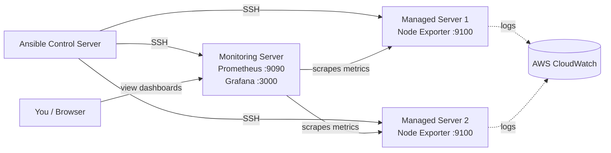

# 🚀 Ansible Monitoring Stack on AWS EC2


Ansible playbooks that automatically set up a complete **monitoring stack** on AWS EC2 servers: **Node Exporter** collects server metrics, **Prometheus** stores them, and **Grafana** shows them as live dashboards. A CloudWatch playbook is also included for sending logs to AWS.

---

## 📌 What this project does

- Installs **Node Exporter** on every managed server
- Installs **Prometheus** and **Grafana** on a monitoring server
- Installs the **CloudWatch agent** to send logs to AWS CloudWatch
- Everything is controlled from **one Ansible control server** over SSH, with no manual setup on each machine

---

## 🏗️ Architecture



---

## 📂 Project structure

| File | What it does |
|---|---|
| `inventory` | List of servers, split into `[monitoring]` and `[nodes]` groups |
| `playbook.yml` | Basic practice playbook |
| `node_exporter.yml` | Installs and starts Node Exporter (port 9100) |
| `prometheus.yml` | Installs Prometheus and sets the scrape targets (port 9090) |
| `grafana.yml` | Installs Grafana (port 3000) |
| `cloudwatch.yml` | Installs the CloudWatch agent and ships logs |

> **Note:** `prometheus.yml` is the Ansible *playbook*. It writes Prometheus's own config file to `/etc/prometheus/prometheus.yml` on the server.

---

## ✅ Prerequisites

- 1 EC2 instance as the **control node** with Ansible installed
- 1 EC2 instance for **monitoring** (t3.small or bigger recommended)
- 1 or more EC2 instances as **managed nodes**
- The control node's **public SSH key** (`id_rsa.pub`) added to `~/.ssh/authorized_keys` on every managed server
- Servers in the same VPC, using **private IPs** in the inventory

### Security group ports

| Port | Used for | Allow from |
|---|---|---|
| 22 | SSH | Control server |
| 9100 | Node Exporter | Monitoring server (private IP) only |
| 9090 | Prometheus UI | Your IP |
| 3000 | Grafana UI | Your IP |

---

## ⚡ Quick start

**1. Clone the repo on the control server**

```bash
git clone https://github.com/priyanshu-0003/ANSIBLE.git
cd ANSIBLE
```

**2. Edit the inventory with your own private IPs**

```ini
[monitoring]
172.31.6.154

[nodes]
172.31.6.154
172.31.10.54
```

**3. Test the connection**

```bash
ansible -i inventory all -m ping
```

**4. Run the playbooks in order**

```bash
ansible-playbook -i inventory node_exporter.yml
ansible-playbook -i inventory prometheus.yml
ansible-playbook -i inventory grafana.yml
```

**5. Optional: send logs to CloudWatch**

```bash
ansible-playbook -i inventory cloudwatch.yml
```

(Attach an IAM role with `CloudWatchAgentServerPolicy` to the servers first.)

---

## 📊 Setting up the Grafana dashboard

1. Open `http://<monitoring-public-ip>:3000` (login `admin` / `admin`)
2. **Connections → Data sources → Add data source → Prometheus**
3. URL: `http://localhost:9090` → **Save & test**
4. **Dashboards → New → Import**, enter ID **`1860`** (Node Exporter Full) → **Load**
5. Select the Prometheus data source → **Import**

You will see live **CPU, memory, disk and network** graphs for every server.

### Check Prometheus targets

Open `http://<monitoring-public-ip>:9090/targets`. Every server should show **UP**.

---

## 📸 Screenshots

> Add your screenshots to a `docs/` folder and uncomment these lines.

<!--


-->

---

## 🛠️ Troubleshooting

| Problem | Cause | Fix |
|---|---|---|
| `No hosts matched` | Playbook's `hosts:` group is missing in the inventory | Add the group (like `[monitoring]`) on its own line |
| `Permission denied (publickey)` | Control server's public key is not on the managed server | Add `id_rsa.pub` to the server's `authorized_keys` |
| Prometheus target **DOWN** with `i/o timeout` | Security group blocks port 9100 | Allow 9100 from the monitoring server's private IP |
| Grafana or Prometheus page won't load | Port 3000 or 9090 not open | Add the inbound rule in the security group |
| Grafana is empty | No data source or dashboard yet | Add the Prometheus data source and import dashboard `1860` |

---

## 🔮 Future improvements

- [ ] Add **Loki + Promtail** to view logs inside Grafana
- [ ] Add **Alertmanager** for email or Slack alerts
- [ ] Convert playbooks into reusable **Ansible roles**
- [ ] Add Grafana data source and dashboard provisioning in the playbook
- [ ] Use **Ansible Vault** for secrets

---

## 📚 What I learned

- Writing and running Ansible ad-hoc commands and playbooks
- SSH key-based authentication between servers
- Inventory groups and how `hosts:` maps to them
- Metrics monitoring with Prometheus and Grafana
- AWS security groups, IAM roles and CloudWatch

---

## 👤 Author

**Priyanshu**
GitHub: [@priyanshu-0003](https://github.com/priyanshu-0003)

⭐ If this helped you, give the repo a star!
